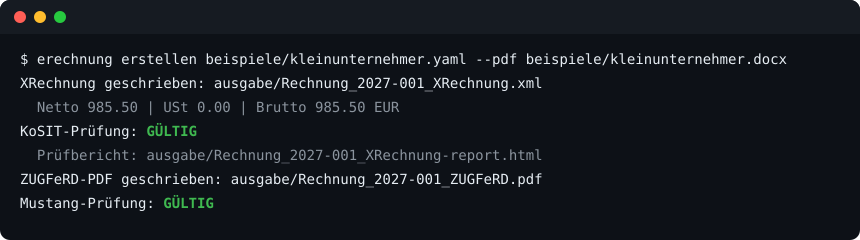

# E-Rechnung DE

Ein Werkzeug für alle, die ihre Rechnungen selbst schreiben und trotzdem E-Rechnungen verschicken wollen oder müssen. Es richtet sich vor allem an Freiberufler, Selbstständige und kleine Firmen.

## Im Browser: https://reyschilling-ai.github.io/e-rechnung-de/

Die einfachste Variante braucht keine Installation. Sie tragen Ihre Daten einmal ein, wählen einen Kunden, erfassen die Positionen und bekommen eine fertige PDF:

- **E-Rechnung:** ZUGFeRD-PDF (PDF/A-3) mit eingebetteter XRechnung 3.0
- **Nur PDF:** eine normale Rechnung als PDF/A, etwa für Privatkunden
- **Rechnungsliste** mit Status offen, überfällig oder bezahlt und erfassten Zahlungseingängen
- **Kundenliste**, Logo, fortlaufende Rechnungsnummern
- **Eine frühere XRechnung einlesen** und als Vorlage nutzen
- **Profil-Datei und Komplettsicherung** zum Mitnehmen auf einen anderen Rechner

Alles läuft in Ihrem Browser, es gibt keinen Server und kein Konto. Rechnungs-, Kunden- und Bankdaten verlassen das Gerät nicht. Vor jeder E-Rechnung laufen die offiziellen Prüfregeln von EN 16931 und XRechnung 3.0 direkt im Browser. Sie stammen aus der KoSIT-Konfiguration und werden in den automatischen Tests Fall für Fall mit dem KoSIT-Validator abgeglichen. Die erzeugten PDFs prüft Mustang mit veraPDF.

Die Daten liegen im Speicher dieses einen Browsers. Wer ihn leert, verliert sie. Die Seite erinnert deshalb an Sicherungen. Eine GoBD-konforme Buchhaltung ersetzt sie nicht.

Der Code der Browser-Version liegt im Ordner [`web/`](web/).

## Für die Kommandozeile

Hier tragen Sie die Rechnungsdaten in eine kurze YAML-Datei ein. Das Werkzeug erzeugt daraus

- eine **XRechnung 3.0** (XML im CII-Format) und
- auf Wunsch eine **ZUGFeRD-PDF** (PDF/A-3 mit eingebettetem XML, Profil XRECHNUNG). Darin steckt deine gewohnte Rechnung als PDF, die du direkt aus Word oder LibreOffice mitgibst.

Jedes Ergebnis wird sofort mit dem **offiziellen KoSIT-Validator** und mit **Mustang** geprüft. Was hier als „GÜLTIG“ herauskommt, besteht dieselben Prüfregeln wie bei Behörden und großen Rechnungsempfängern.



[](https://github.com/reyschilling-ai/e-rechnung-de/actions/workflows/tests.yml)

> **Kein Steuerrat.** Das Werkzeug prüft Format und Pflichtfelder, nicht deine steuerliche Einordnung. Ob ein Umsatz steuerfrei, steuerpflichtig oder Reverse Charge ist, musst du selbst entscheiden oder mit deiner Steuerberatung klären. Nutzung auf eigenes Risiko.

## Muss ich überhaupt E-Rechnungen schreiben?

Ein kurzer Überblick für Rechnungen an Unternehmen in Deutschland (B2B), Stand November 2026:

| Wer | Pflicht zum Ausstellen von E-Rechnungen |
|---|---|
| Alle Unternehmen | müssen E-Rechnungen seit 1.1.2025 **empfangen** können |
| Vorjahresumsatz über 800.000 € | ab 1.1.2027 |
| alle übrigen Unternehmen | ab 1.1.2028 |
| Kleinunternehmer nach § 19 UStG | ausgenommen (§ 34a UStDV) |
| Kleinbetragsrechnungen bis 250 € brutto | ausgenommen |

Freiwillig darfst du E-Rechnungen schon jetzt schicken. Viele große Kunden bitten inzwischen darum, weil sie Rechnungen automatisch verarbeiten. Verbindlich ist das Schreiben des Bundesfinanzministeriums zur E-Rechnung.

**Wichtig:** Eine normale PDF ist keine E-Rechnung. Gemeint ist ein strukturiertes Format nach EN 16931, also XRechnung oder ZUGFeRD ab Version 2.0.1 (ohne die Profile MINIMUM und BASIC-WL).

## Installation

Voraussetzungen: Python ab 3.10 und Java ab 11. Für die Umwandlung von Word-Dateien brauchst du außerdem LibreOffice; das ist optional.

```bash
git clone https://github.com/reyschilling-ai/e-rechnung-de.git
cd e-rechnung-de
pip install -e .
erechnung werkzeuge      # lädt KoSIT-Validator und Mustang einmalig herunter (~35 MB)
```

Die Prüfwerkzeuge landen in `~/.cache/e-rechnung-de`. Ein anderer Ort lässt sich über die Umgebungsvariable `ERECHNUNG_WERKZEUGE` einstellen. Jeder Download wird per SHA-256 gegen eine feste Prüfsumme kontrolliert.

## Nutzung

```bash
# nur XRechnung (XML)
erechnung erstellen beispiele/kleinunternehmer.yaml

# XRechnung + ZUGFeRD-PDF aus deiner Word-Rechnung
erechnung erstellen beispiele/kleinunternehmer.yaml --pdf beispiele/kleinunternehmer.docx

# vorhandene Datei prüfen (XML mit KoSIT, PDF mit Mustang)
erechnung pruefen Rechnung_2027-001_ZUGFeRD.pdf
```

Die Ergebnisse landen in `./ausgabe` (änderbar mit `-o`), zusammen mit dem Prüfbericht als HTML.

Bei `--pdf` kannst du eine `.docx` angeben (wird mit LibreOffice in PDF/A umgewandelt) oder eine fertige PDF/A. In Word: *Speichern unter → PDF → Optionen → „PDF/A-kompatibel“*. Eine normale PDF lehnt Mustang ab.

**Wichtig:** Die sichtbare PDF und das eingebettete XML müssen inhaltlich übereinstimmen. Das Werkzeug liest deine PDF nicht aus. Wenn du dich in der YAML-Datei vertippst, steht in der PDF etwas anderes als im XML, und rechtlich zählt das XML.

## Die Rechnungsdaten

Am schnellsten geht es, wenn du ein Beispiel kopierst:

| Datei | Fall |
|---|---|
| [`beispiele/kleinunternehmer.yaml`](beispiele/kleinunternehmer.yaml) | Kleinunternehmer § 19 UStG, Kunde in Deutschland |
| [`beispiele/regelbesteuert.yaml`](beispiele/regelbesteuert.yaml) | 19 % und 7 % gemischt, Leistungszeitraum, Bestellnummer |
| [`beispiele/reverse_charge_eu.yaml`](beispiele/reverse_charge_eu.yaml) | Dienstleistung an ein Unternehmen in der EU |

### Pflichtangaben

| Feld | Bedeutung |
|---|---|
| `steuerfall` | `regulaer`, `kleinunternehmer` oder `reverse_charge`; gilt für alle Positionen, kann je Position überschrieben werden |
| `steuersatz` | nur bei `regulaer`, z. B. `19` oder `7`; auch je Position möglich |
| `rechnung.nummer`, `rechnung.datum` | Datum im Format `JJJJ-MM-TT` |
| `rechnung.leistungsdatum` **oder** `rechnung.leistungszeitraum.von/bis` | Zeitpunkt oder Zeitraum der Leistung |
| `verkaeufer.name`, `.anschrift`, `.email`, `.telefon` | Telefon und E-Mail verlangt XRechnung als Kontaktdaten |
| `verkaeufer.steuernummer` und/oder `.ust_id` | mindestens eins davon |
| `kaeufer.name`, `.anschrift`, `.email` | die E-Mail-Adresse für den Rechnungseingang des Kunden; in XRechnung 3.0 Pflicht |
| `kaeufer.ust_id` | nur bei Reverse Charge Pflicht |
| `positionen[]` | je Position `bezeichnung`, `einzelpreis` (netto), optional `menge`, `einheit`, `beschreibung` |
| `zahlung.iban` | wird auf Prüfsumme kontrolliert |

### Optionale Angaben

- `rechnung.kaeuferreferenz`: die Referenz des Kunden, etwa eine Bestellnummer oder bei Behörden die Leitweg-ID. Ohne Angabe wird `n/a` eingetragen. Das ist gültig, aber frag deinen Kunden lieber, was er dort sehen will.
- `rechnung.bestellnummer`
- `zahlung.ziel_tage` oder `zahlung.faellig_am`, `zahlung.bedingungen` (eigener Text), `zahlung.bic`, `zahlung.kontoinhaber`
- `anschrift.zusatz`, `anschrift.land` (ISO-Code, Standard `DE`)
- `verkaeufer.kennung`: eigene Verkäuferkennung (BT-29). Ohne USt-IdNr. wird automatisch die Steuernummer eingetragen, weil die Prüfregel BR-CO-26 eine Kennung verlangt.
- `hinweise`: freie Hinweise auf der Rechnung. Den Kleinunternehmer- bzw. Reverse-Charge-Hinweis ergänzt das Werkzeug selbst.

### Einheiten

`stueck`, `stunde`, `tag`, `monat`, `pauschal`, `kilometer`. Alternativ kannst du direkt einen Code aus UN/ECE Recommendation 20 angeben.

## Mit Claude nutzen

Im Ordner [`skill/e-rechnung`](skill/e-rechnung/SKILL.md) liegt ein Skill für Claude. Du lädst deine Word- oder PDF-Rechnung hoch und sagst „Mach daraus eine E-Rechnung“. Claude liest die Rechnung aus, füllt die YAML-Datei, fragt nach fehlenden Pflichtangaben wie der E-Mail-Adresse des Kunden und liefert die geprüfte ZUGFeRD-PDF zurück.

## Was (noch) nicht geht

- Gutschriften und Rechnungskorrekturen (Typ 381/384)
- Rabatte und Zuschläge auf Rechnungsebene
- Zahlungsarten außer SEPA-Überweisung
- UBL-Syntax (erzeugt wird CII; das nehmen alle gängigen Empfänger an)
- Versand über PEPPOL
- Steuerfälle wie innergemeinschaftliche Lieferung von Waren (K), Ausfuhr (G) oder steuerfreie Umsätze nach § 4 UStG

Beiträge sind willkommen. Jeder neue Steuerfall braucht ein Beispiel in `beispiele/`, das den KoSIT-Validator besteht.

## Tests

```bash
pip install -e ".[test]"
pytest
```

Die schnellen Tests prüfen Berechnung und Pflichtfelder. Die Validierungstests jagen alle Beispiele durch KoSIT und Mustang; sie laufen nur, wenn Java installiert ist.

## Verwendete Werkzeuge

Die Werkzeuge werden nicht mit diesem Repo verteilt, sondern beim ersten Lauf von den offiziellen Quellen geladen:

- [KoSIT-Validator](https://github.com/itplr-kosit/validator) und [XRechnung-Konfiguration](https://github.com/itplr-kosit/validator-configuration-xrechnung) (Apache 2.0), die offizielle Prüfung der Koordinierungsstelle für IT-Standards
- [Mustang](https://github.com/ZUGFeRD/mustangproject) (Apache 2.0) für Erzeugung und Prüfung von ZUGFeRD-PDFs

Die Browser-Version bringt ihre Bestandteile im Ordner `web/` mit. Eine Übersicht steht auf der Seite [Lizenzen](web/lizenzen.html). Die aus den EN-16931-Artefakten abgeleitete Regeldatei `web/regeln/regeln.json` steht unter der EUPL 1.2.

## Lizenz

MIT, siehe [LICENSE](LICENSE). Keine Gewähr für steuerliche oder rechtliche Richtigkeit.
